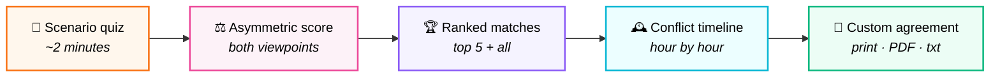
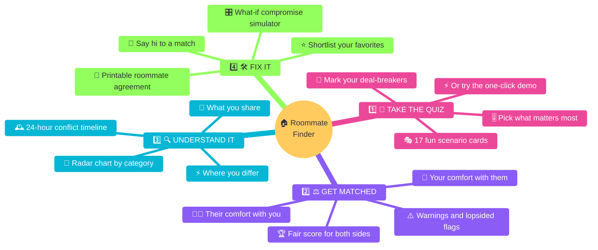
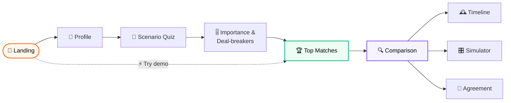
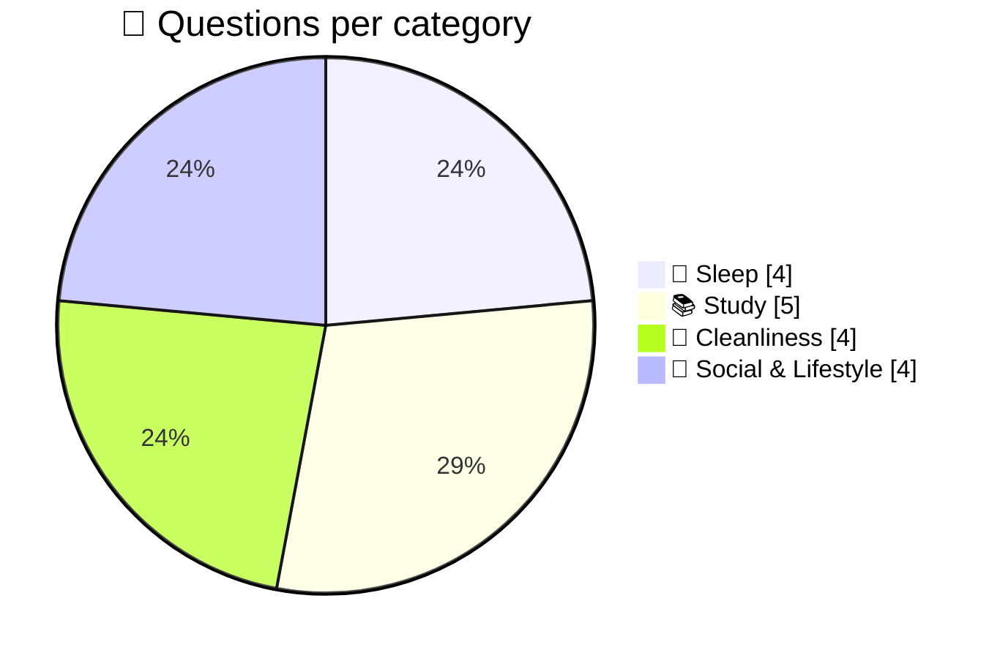
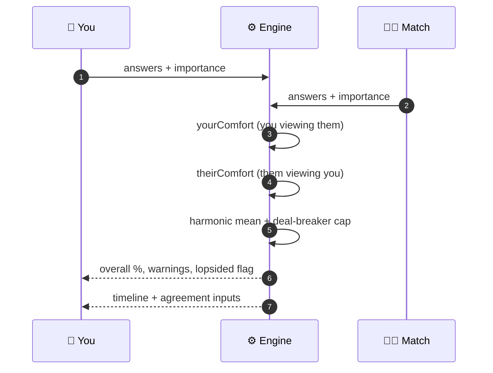
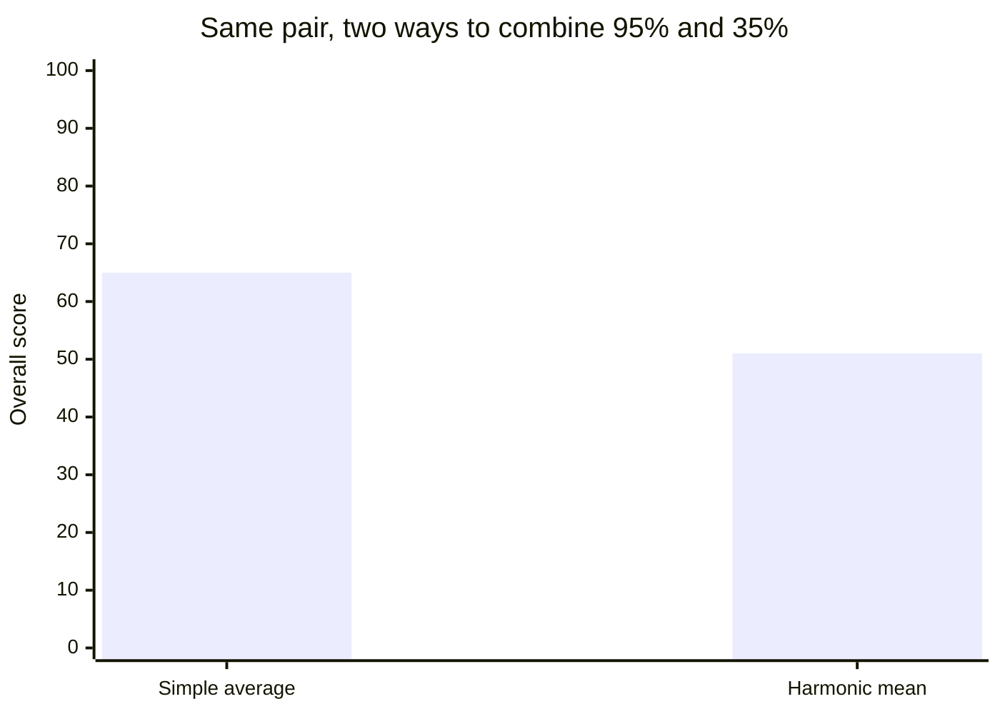
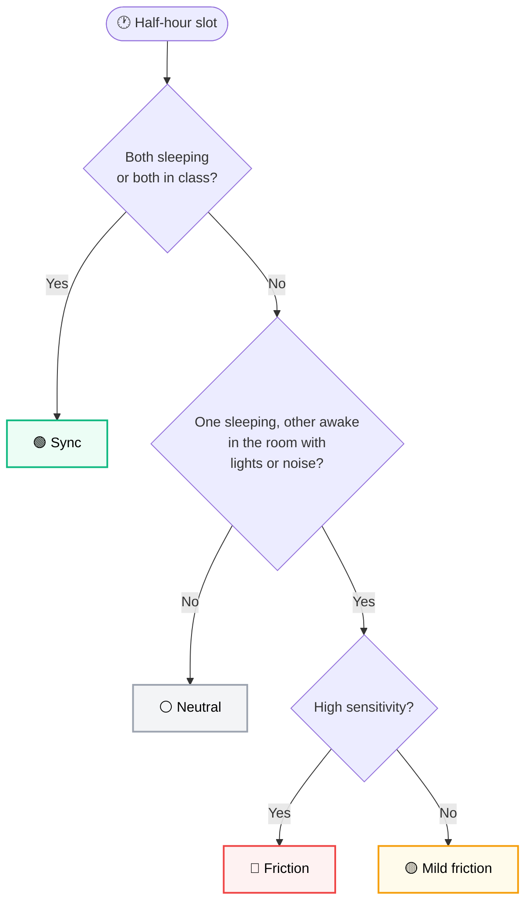
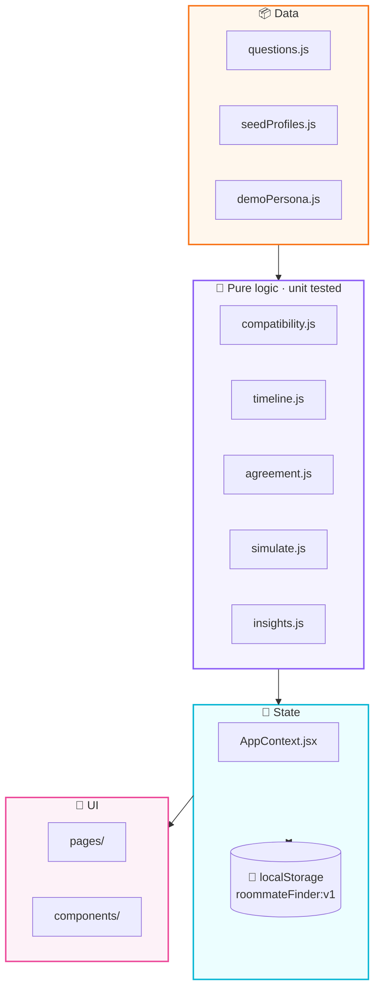

<div align="center">


<br><br>


<br><br>

**[✨ Features](#-key-features)** &nbsp;·&nbsp;
**[🔄 Flow](#-user-flow)** &nbsp;·&nbsp;
**[🧠 Engine](#-the-compatibility-engine)** &nbsp;·&nbsp;
**[🕰 Timeline](#-the-24-hour-conflict-timeline)** &nbsp;·&nbsp;
**[📜 Agreement](#-roommate-agreement-generator)** &nbsp;·&nbsp;
**[🚀 Run It](#-getting-started)** &nbsp;·&nbsp;
**[🎬 Demo](#-2-minute-demo-script)** &nbsp;·&nbsp;
**[👥 Team](#-team)**

</div>

<br>

---

## 💬 The Pitch

<div align="center">

> ### ❝ Other apps give you a compatibility percentage and hope for the best. ❞
> ### ❝ Ours shows you the **exact hour of the day you'll fight**, and generates a **customized agreement** to prevent it **before you move in.** ❞

</div>

<br>

## 🥊 Why We're Different

| | 😐 Typical roommate apps | 🏠 **Roommate Finder** |
|---|:---:|:---:|
| **Quiz style** | Dull numeric forms | 🎭 Funny scenario cards, no numbers shown |
| **Score** | One flat percentage | ⚖️ Two scores: *your* comfort and *their* comfort |
| **Lopsided pairs** | Hidden by averaging | 🔍 Flagged, naming who adjusts more |
| **Conflicts** | "Hope for the best" | 🕰️ Hour-by-hour conflict timeline |
| **Fixing them** | Nothing | 🎛️ Live compromise simulator |
| **Next step** | Nothing | 📜 Printable, customized house rules |
| **Deal-breakers** | Often ignored | 🚨 Detected, with a hard score cap |

<br>

## 🎯 The Problem

Random roommate pairings fail for small, daily reasons, not big ones.

<div align="center">

| 🌙 **Sleep** | 📚 **Study** | 🧹 **Cleanliness** | 🎉 **Social** |
|:--:|:--:|:--:|:--:|
| One sleeps at 10 PM | One studies loudly at 2 AM | One washes dishes today, one next week | One loves guests, one needs silence |

</div>

Most "roommate matchers" compress all of this into one number and stop there. A single percentage can't tell you **who** is uncomfortable, **when** it happens, or **what to do about it**.

<br>

## 💡 Our Solution



<br>

---

## ✨ Key Features

<table>
<tr>
<td width="50%" valign="top">

### 🎭 Scenario-Based Quiz
17 funny, hostel-relatable scenario cards. **No numeric scales ever shown.** Answers map to hidden values.

### ⚖️ Asymmetric Compatibility
Computes how comfortable **you** would be with **them** *and* how comfortable **they** would be with **you**.

### 🚨 Deal-Breaker Detection
Smoking, overnight guests, and room temperature. A hard clash caps the score at **60%**.

### 📡 Radar Chart
Four category scores, both directions overlaid as two shapes.

</td>
<td width="50%" valign="top">

### 🕰 24-Hour Conflict Timeline
See the exact windows where one of you sleeps while the other studies with lights on.

### 🎛 Compromise Simulator
Toggle small changes and watch the score and friction hours update **live**.

### 📜 Roommate Agreement
One click generates house rules built **only** from your real friction points.

### ⭐ Shortlist, Filters & More
Shortlist matches, filter and sort, copy a summary, and send a "Say hi" intro.

</td>
</tr>
</table>

<div align="center">

🌗 Dark mode &nbsp;·&nbsp; ♿ Keyboard accessible &nbsp;·&nbsp; 📱 Works at 375 px &nbsp;·&nbsp; 💾 Auto-saves progress &nbsp;·&nbsp; 🎬 One-click demo &nbsp;·&nbsp; 🖨 Print to PDF

</div>

### 🗺 Feature Map

*Read it clockwise: **take the quiz → get matched → understand the result → fix the problems.***



<div align="center">

| 1️⃣ **Take the quiz** | 2️⃣ **Get matched** | 3️⃣ **Understand it** | 4️⃣ **Fix it** |
|:--:|:--:|:--:|:--:|
| Answer fun scenarios in about 2 minutes | See how comfortable *both* of you would be | See exactly where and when you'd clash | Compromise live and generate house rules |

</div>

<br>

---

## 🔄 User Flow



<br>

---

## 📝 The Questionnaire

Four categories, **17 scenario cards**, about **2 minutes**. Every question is defined in `src/data/questions.js`, so adding a question needs **zero UI changes**.



| | Category | Questions | Sample scenario |
|:--:|---|:--:|---|
| 🌙 | **Sleep** | 4 | *"Your roommate's phone buzzes at 2 AM. You…"* |
| 📚 | **Study** | 5 | *"Exam tomorrow. Your roommate wants a lo-fi playlist on speaker. You say…"* |
| 🧹 | **Cleanliness** | 4 | *"3-day-old Maggi bowls on your desk at 1 AM before mid-sems. You…"* |
| 🎉 | **Social & Lifestyle** | 4 | *"After a long week your ideal Saturday is…"* |

<details>
<summary><b>📋 See all 17 questions</b></summary>

<br>

| Category | Question | Scoring |
|---|---|---|
| 🌙 Sleep | Bedtime | Directional |
| 🌙 Sleep | Wake time | Directional |
| 🌙 Sleep | Light sleeper | **Modifier** (sets sensitivity) |
| 🌙 Sleep | Screens at night | Directional |
| 📚 Study | Study time (circular) | Symmetric |
| 📚 Study | Study hours | Symmetric |
| 📚 Study | Study noise | Directional |
| 📚 Study | Study location | Symmetric (low weight) |
| 📚 Study | Class timing | Symmetric (low weight) |
| 🧹 Cleanliness | Tidiness | Directional |
| 🧹 Cleanliness | Cleaning frequency | Directional |
| 🧹 Cleanliness | Dishes & laundry | Directional |
| 🧹 Cleanliness | Mess tolerance | **Modifier** (sets sensitivity) |
| 🎉 Social | Overnight guests | Directional |
| 🎉 Social | Social energy | Symmetric |
| 🎉 Social | Smoking | Matrix (not compromisable) |
| 🎉 Social | Room temperature | Symmetric |

</details>

### 🎚 Importance Sliders

Each student tells us how much each category matters (1 to 5). If skipped, these defaults apply:

```
  🌙 Sleep         ████████████████████  4 / 5
  🧹 Cleanliness   ████████████████████  4 / 5
  📚 Study         ███████████████       3 / 5
  🎉 Social        ██████████            2 / 5
```

<br>

---

## 🧠 The Compatibility Engine

All logic lives in pure, unit-tested functions in `src/utils/compatibility.js`.

### 🤝 How a pair gets scored



### 🔀 Why asymmetric?

A messy person living with a neat person is fine. A neat person living with a messy person is **not**. Averaging the two hides this.

<div align="center">

| 👀 Viewer | 🏠 Roommate | 🧹 Cleanliness comfort |
|:--:|:--:|:--:|
| 🙂 Messy | 🧼 Neat | 🟢 **≥ 85%** |
| 😣 Neat | 🙂 Messy | 🔴 **≤ 35%** |

*Same pair. Very different experience.*

</div>

### 🪜 The scoring pipeline

```
 1  Normalize answers            ordinal → index/(n−1)      scale → (v−1)/4
 2  Score each question          symmetric → 1 − |a−b|/range    (studyTime uses circular distance)
                                 directional → comfort from the viewer's side only
 3  Apply sensitivity            light sleepers feel sleep clashes harder
                                 low mess-tolerance feels cleanliness clashes harder
 4  Roll up by category          weighted average per category
 5  Weight by importance         the viewer's own 1–5 sliders, normalized
 6  Compute BOTH directions      yourComfort  and  theirComfort
 7  Combine with harmonic mean   overall = 2·Y·T / (Y + T)
 8  Apply deal-breaker cap       hard clash → overall capped at 60
```

### 🎯 Sensitivity multipliers

Some answers don't score directly. They change **how strongly** a clash is felt.

| Modifier question | Answer | Effect on that viewer |
|---|---|---|
| 🌙 **Light sleeper** (sleep clashes) | Barely wakes → **1** | `×0.6` &nbsp;`██░░░░░░░░` &nbsp;feels less |
| | Wakes instantly → **5** | `×1.5` &nbsp;`██████████` &nbsp;feels much more |
| 🧹 **Mess tolerance** (cleanliness clashes) | Bugs me all day → **1** | `×1.5` &nbsp;`██████████` &nbsp;feels much more |
| | Wouldn't notice → **5** | `×0.6` &nbsp;`██░░░░░░░░` &nbsp;feels less |

### 🚬 Smoking matrix

Smoking uses its own lookup. Rows are **the viewer**, columns are **their roommate**.

| Viewer ↓ &nbsp;/&nbsp; Roommate → | 🚭 None | 🌬 Outside only | 🚬 Yes |
|---|:--:|:--:|:--:|
| **🚭 None** | 🟢 1.0 | 🟡 0.5 | 🔴 0.0 |
| **🌬 Outside only** | 🟢 1.0 | 🟢 1.0 | 🟡 0.5 |
| **🚬 Yes** | 🟢 0.8 | 🟢 0.9 | 🟢 1.0 |

### 🧮 Why the harmonic mean?

```
  yourComfort 95%  ·  theirComfort 35%

  Average          →  65%   "Fair"        ← hides the problem
  Harmonic mean    →  51%   "Challenging" ← tells the truth
```



> 💡 A roommate pairing is only as good as its **less comfortable person**. The harmonic mean punishes lopsided matches by design.

### 🏅 Match tiers

| Score | Tier | |
|:--:|:--:|---|
| **85+** | 🟢 Excellent | `██████████` |
| **70–84** | 🔵 Good | `███████░░░` |
| **55–69** | 🟡 Fair | `█████░░░░░` |
| **< 55** | 🔴 Challenging | `██░░░░░░░░` |

### 🚨 Hard deal-breakers

| Deal-breaker | Clash happens when |
|---|---|
| 🚬 **Smoking** | One says *none*, the other says *yes* |
| 🌙 **Overnight guests** | One says *never*, the other says *often* |
| 🌡 **Room temperature** | One says *cool*, the other says *warm* |

A clash **always** shows a ⚠️ warning badge. If **either** person marked it as *hard*, the pair's overall score is **capped at 60**.

### 🏷 Extra signals on every match

- ↔️ **Lopsided badge** when the comfort gap is 20 points or more, naming who carries more of the adjustment
- 🤝 Top 3 **shared traits**
- ⚡ Top 3 **biggest differences**

<br>

---

## 🕰 The 24-Hour Conflict Timeline

Each person's day becomes **48 half-hour slots**: `sleep` › `class` › `study` › `free`.

```
  6PM         9PM         12AM        3AM         6AM         9AM         12PM        3PM         6PM
  │           │           │           │           │           │           │           │           │
  You    ░░░░░░▓▓▓▓▓▓▓▓▓▓▓▓▓▓▓▓▓▓▓▓▓▓▓▓▓▓▓▓▓▓▓▓▓▓▓▓░░░░░░████████████████░░░░░░░░░░░░░░░░░░░░░░░░
  Aarav  ░░░░░░░░░░░░░░░░░░░░▒▒▒▒▒▒▒▒▒▒▒▒▒▒▒▓▓▓▓▓▓▓▓▓▓▓▓▓▓▓▓▓▓▓▓▓▓▓▓▓▓▓▓▓░░░░░░░░░░░░░░░░░░░░░░░░░░
  Zone   ······················🔴🔴🔴🔴🔴🔴····································

  ▓ sleep     █ class     ▒ study     ░ free        🟢 sync   🟡 mild friction   🔴 friction
```
*Illustrative sketch. The app renders this as a color-coded interactive SVG.*

### 🚦 How each slot gets its color


*Simplified view of the rules.*

| Zone | When it happens |
|:--:|---|
| 🟢 **Sync** | Both sleeping, or both in class |
| 🔴 **Friction** | One sleeps while the other studies in the room with lights on or noise, and the sleeper is a light sleeper |
| 🟡 **Mild friction** | Same situation, lower sensitivity |

**Output:** plain-English windows such as *"11:30 PM – 1:30 AM: You're sleeping, Aarav is studying with lights on"*, plus daily totals for friction, both-asleep, and both-in-class hours. The axis starts at **6 PM** so the night is one unbroken stretch.

<br>

---

## 🎛 Compromise Simulator

> ### 🤔 *"What if I compromise?"*

- 🔎 Auto-detects the **top 3** changes that would improve the match the most (smoking is never offered)
- 👥 Choose **who compromises**: `Me` · `Them` · `Both`
- ⚡ Score and timeline recompute **live**: &nbsp; `78%` ➜ `88%` &nbsp; **+10**
- 🔒 Never touches your saved answers, and a **Reset** button restores everything

```
  Before   ███████████████░░░░░   78%
  After    █████████████████░░░   88%   ▲ +10
```
*Example of the live before-and-after.*

<br>

## 📜 Roommate Agreement Generator

House rules built **only from real friction**, never from generic filler.

| 🔎 Source of a rule | 📝 Example |
|---|---|
| Question with comfort below 75% | *Quiet hours after 11 PM: headphones and desk lamp only* |
| Hard deal-breaker clash | *No smoking in the room* |
| Red / amber timeline window | *Calls taken outside during sleep hours* |

Each rule carries a **"Because:"** chip quoting the actual answers behind it.

- ✅ Accept or dismiss each rule
- ➕ Add your own custom rule
- ✍️ Editable names and signature lines
- 🔁 "Review together in 2 weeks" clause
- 🖨 **Print / Save as PDF** &nbsp;·&nbsp; 📄 **Download .txt** &nbsp;·&nbsp; 📋 **Copy text**

*If there's no real friction, you get a friendly "You two are already in sync" starter card.*

<br>

---

## 🏗 Architecture



<br>

---

## 🛠 Tech Stack

| Layer | Choice | Why |
|---|---|---|
| ⚛️ UI | React + hooks, React Router | Small, focused components |
| 🎨 Styling | Tailwind CSS | Fast, consistent design system |
| 🎯 Icons | lucide-react | Lightweight icon set |
| 📊 Charts | Hand-built SVG/CSS | Radar and timeline with zero chart libraries |
| 💾 Storage | `localStorage` (`roommateFinder:v1`) | No backend, safe fallback if unavailable |
| 🖨 Export | `window.print()` + print stylesheet | No PDF library needed |
| 🧪 Tests | Vitest | Pure logic is fully unit tested |

**No backend.** Everything runs in the browser, and a corrupted or unavailable storage resets safely.

<br>

---

## 🧱 Built in Three Phases

| Phase | Focus | What lands |
|:--:|---|---|
| 🥇 **1** | **Core** | Scaffold, questions, scoring engine + tests, seed data, quiz, results, comparison, persistence, demo, How it works |
| 🥈 **2** | **Signature features** | 24-hour Conflict Timeline, Roommate Agreement generator |
| 🥉 **3** | **Polish & stretch** | Compromise Simulator, shortlist, filters & sorting, dark mode, copy summary, "Say hi", animations, accessibility pass |

<br>

---

## 📁 Project Structure

```
roommate-finder/
├── 📄 index.html
├── 📄 package.json
├── 📄 README.md
└── 📂 src/
    ├── main.jsx
    ├── App.jsx
    ├── index.css                 # includes print styles
    │
    ├── 📂 context/
    │   └── AppContext.jsx        # profile, answers, importance, shortlist, theme, persistence
    │
    ├── 📂 data/
    │   ├── questions.js          # the single source of truth for the quiz
    │   ├── seedProfiles.js       # 12 realistic student profiles
    │   └── demoPersona.js        # the "Try demo" user
    │
    ├── 📂 utils/                 # pure, testable logic
    │   ├── compatibility.js      # asymmetric scoring engine
    │   ├── timeline.js           # 48-slot day builder + friction zones
    │   ├── agreement.js          # rule templates + export
    │   ├── simulate.js           # compromise detection + live recompute
    │   ├── insights.js           # shared traits, differences, summary
    │   └── storage.js            # safe localStorage wrapper
    │
    ├── 📂 pages/                 # Landing · ProfileSetup · Quiz · Importance
    │                             # Results · Compare · Shortlist · HowItWorks · NotFound
    ├── 📂 components/            # MatchCard · ScoreMeter · RadarChart · Timeline · ScenarioCard
    │                             # ComparisonTable · CompromisePanel · AgreementModal · Modal · Toast …
    └── 📂 tests/                 # compatibility · timeline · agreement · simulate · demo
```

<br>

---

## 🚀 Getting Started

```bash
# 1 · Clone
git clone https://github.com/<your-username>/roommate-finder.git
cd roommate-finder

# 2 · Install
npm install

# 3 · Run
npm run dev

# 4 · Test
npm test

# 5 · Production build
npm run build
```

| Command | What it does |
|---|---|
| `npm install` | 📦 Installs dependencies |
| `npm run dev` | ⚡ Starts the dev server |
| `npm test` | 🧪 Runs the Vitest suite |
| `npm run build` | 🏗 Creates the production build |

<br>

---

## 🎬 2-Minute Demo Script

| ⏱ Time | 🎯 Action | 🎤 What to say |
|:--:|---|---|
| **0:00** | Open landing, click **⚡ Try demo** | *"Other apps give you a percentage and hope for the best."* |
| **0:20** | Show the **🏆 top match** (85+, almost no friction) | *"A genuinely great fit, and here's why."* |
| **0:40** | Open **Aarav**: 60–78% overall | *"Looks decent, but look at the two comfort scores."* |
| **1:00** | Point at the **↔️ Lopsided** badge | *"You'd be 20+ points less comfortable than he would."* |
| **1:15** | Scroll to the **🕰 Conflict Timeline** | *"Here's the exact hour we'd fight: he studies with lights on while you sleep."* |
| **1:35** | Toggle the **🎛 Compromise Simulator** | *"One small change and the score jumps, live."* |
| **1:50** | Click **📜 Generate Agreement** | *"And here's the house rules card to prevent it before move-in."* |

```
  0:00 ▶━━━━━━━━●━━━━━━━●━━━━━━●━━━━━━●━━━━━━━●━━━━━━━●━━▶ 2:00
       Demo      Top    Aarav  Lopsided Timeline Simulator Agreement
```

<br>

---

## 🧪 Quality & Testing

<table>
<tr>
<td width="50%" valign="top">

- ✅ Identical answers score **100**
- ✅ Messy-with-neat vs neat-with-messy asymmetry verified
- ✅ Deal-breaker cap and mutual gender filter verified

</td>
<td width="50%" valign="top">

- ✅ Deterministic tie-breaking
- ✅ No `NaN` on missing answers
- ✅ Circular study-time distance verified
- ✅ **Demo invariants** enforced by tests, so tuning can never break the demo

</td>
</tr>
</table>

## ♿ Accessibility

⌨️ Keyboard navigation everywhere &nbsp;·&nbsp; 🎯 Visible focus states &nbsp;·&nbsp; 🏷 ARIA roles on progress bars and dialogs &nbsp;·&nbsp; 🌗 Light and dark mode contrast &nbsp;·&nbsp; 🐢 `prefers-reduced-motion` respected &nbsp;·&nbsp; 🔊 Screen-reader summaries for the timeline and charts

<br>

---

## 📌 Assumptions

- 👥 Students are matched within a **built-in pool of 12 seed profiles** (no backend)
- 🔁 Gender preference is applied **mutually** (your preference AND theirs)
- 🕐 Timeline times are **estimates** derived from questionnaire answers, not real schedules

## 🔮 Future Ideas

- [ ] 🔐 Real backend and authentication
- [ ] 💬 In-app chat between matched students
- [ ] 🤖 ML-based matching
- [ ] 📅 Calendar import for **exact** schedules instead of estimates
- [ ] 🧩 More categories: budget, noise, guests, food

<br>

---

## 👥 Team

| Name | Role | GitHub |
|---|---|---|
| *R. Ashwin Kumar* | *leader* | [@Ashhh2906](https://github.com/Ashhh2906) |
| *Rehan Hasan* | *Developer* | [@Rehanhsn](https://github.com/Rehanhsn) |
| *Pragati Joshi* | *researcher* | |

<br>

<div align="center">

### 🏠 Built for a college hackathon, because roommate fights are preventable.

⭐ **Star the repo if it made you rethink "compatibility".** ⭐


</div>
