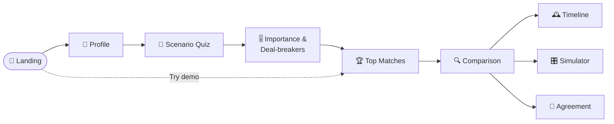

<div align="center">

<br>

# 🏠 &nbsp;R O O M M A T E &nbsp; F I N D E R

### *Don't just find a roommate. Find out when you'll fight, before you move in.*

<br>


<br><br>

**[✨ Features](#-key-features)** &nbsp;·&nbsp;
**[🧠 The Engine](#-the-compatibility-engine)** &nbsp;·&nbsp;
**[🕰 Timeline](#-the-24-hour-conflict-timeline)** &nbsp;·&nbsp;
**[📜 Agreement](#-roommate-agreement-generator)** &nbsp;·&nbsp;
**[🚀 Run It](#-getting-started)** &nbsp;·&nbsp;
**[🎬 Demo](#-2-minute-demo-script)**

<br>

</div>

---

## 💬 The Pitch

> **Other apps give you a compatibility percentage and hope for the best.**
> **Ours shows you the exact hour of the day you'll fight, and generates a customized agreement to prevent it before you move in.**

<br>

## 🎯 The Problem

Random roommate pairings fail for small, daily reasons, not big ones.

| 🌙 | 📚 | 🧹 | 🎉 |
|:--:|:--:|:--:|:--:|
| One sleeps at 10 PM | One studies loudly at 2 AM | One washes dishes today, one next week | One loves guests, one needs silence |

Most "roommate matchers" compress all of this into one number and stop there. A single percentage can't tell you **who** is uncomfortable, **when** it happens, or **what to do about it**.

<br>

## 💡 Our Solution

```
   Scenario quiz  ─►  Asymmetric score  ─►  Ranked matches  ─►  Conflict timeline  ─►  Custom agreement
   (2 minutes)        (both viewpoints)     (top 5 + all)       (hour by hour)         (print / PDF / txt)
```

<br>

---

## ✨ Key Features

<table>
<tr>
<td width="50%" valign="top">

### 🎭 Scenario-Based Quiz
17 funny, hostel-relatable scenario cards. **No numeric scales ever shown**, and answers map to hidden values.

### ⚖️ Asymmetric Compatibility
Computes how comfortable **you** would be with **them** *and* how comfortable **they** would be with **you**.

### 🚨 Deal-Breaker Detection
Smoking, overnight guests, and room temperature. A hard clash caps the score at **60%**.

</td>
<td width="50%" valign="top">

### 🕰 24-Hour Conflict Timeline
See the exact windows where one of you sleeps while the other studies with lights on.

### 🎛 Compromise Simulator
Toggle small changes and watch the score and the friction hours update **live**.

### 📜 Roommate Agreement
One click generates house rules built **only** from your real friction points.

</td>
</tr>
</table>

**Also included:** radar chart · question-by-question comparison · shortlist · filters & sorting · dark mode · "Say hi" intro modal · copy summary · full keyboard accessibility · works at 375 px.

<br>

---

## 🔄 User Flow



<br>

---

## 📝 The Questionnaire

Four categories, **17 scenario cards**, about **2 minutes**. Every question is defined in `src/data/questions.js`, so adding a question needs **zero UI changes**.

| | Category | Questions | Sample scenario |
|:--:|---|:--:|---|
| 🌙 | **Sleep** | 4 | *"Your roommate's phone buzzes at 2 AM. You…"* |
| 📚 | **Study** | 5 | *"Exam tomorrow. Your roommate wants a lo-fi playlist on speaker. You say…"* |
| 🧹 | **Cleanliness** | 4 | *"3-day-old Maggi bowls on your desk at 1 AM before mid-sems. You…"* |
| 🎉 | **Social & Lifestyle** | 4 | *"After a long week your ideal Saturday is…"* |

<details>
<summary><b>📋 See all 17 questions</b></summary>

<br>

| Category | Question | Scoring |
|---|---|---|
| 🌙 Sleep | Bedtime | Directional |
| 🌙 Sleep | Wake time | Directional |
| 🌙 Sleep | Light sleeper | **Modifier** (sets sensitivity) |
| 🌙 Sleep | Screens at night | Directional |
| 📚 Study | Study time (circular) | Symmetric |
| 📚 Study | Study hours | Symmetric |
| 📚 Study | Study noise | Directional |
| 📚 Study | Study location | Symmetric (low weight) |
| 📚 Study | Class timing | Symmetric (low weight) |
| 🧹 Cleanliness | Tidiness | Directional |
| 🧹 Cleanliness | Cleaning frequency | Directional |
| 🧹 Cleanliness | Dishes & laundry | Directional |
| 🧹 Cleanliness | Mess tolerance | **Modifier** (sets sensitivity) |
| 🎉 Social | Overnight guests | Directional |
| 🎉 Social | Social energy | Symmetric |
| 🎉 Social | Smoking | Matrix (not compromisable) |
| 🎉 Social | Room temperature | Symmetric |

</details>

<br>

---

## 🧠 The Compatibility Engine

All logic lives in pure, unit-tested functions in `src/utils/compatibility.js`.

### Why asymmetric?

A messy person living with a neat person is fine. A neat person living with a messy person is **not**. Averaging the two hides this.

<div align="center">

| Viewer | Roommate | Cleanliness comfort |
|:--:|:--:|:--:|
| 🙂 Messy | 🧼 Neat | **≥ 85%** |
| 😣 Neat | 🙂 Messy | **≤ 35%** |

*Same pair. Very different experience.*

</div>

### The scoring pipeline

```
 1  Normalize answers            ordinal → index/(n−1)      scale → (v−1)/4
 2  Score each question          symmetric → 1 − |a−b|/range    (studyTime uses circular distance)
                                 directional → comfort from the viewer's side only
 3  Apply sensitivity            light sleepers feel sleep clashes harder
                                 low mess-tolerance feels cleanliness clashes harder
 4  Roll up by category          weighted average per category
 5  Weight by importance         the viewer's own 1–5 sliders, normalized
 6  Compute BOTH directions      yourComfort  and  theirComfort
 7  Combine with harmonic mean   overall = 2·Y·T / (Y + T)
 8  Apply deal-breaker cap       hard clash → overall capped at 60
```

### Why the harmonic mean?

```
  yourComfort 95%  ·  theirComfort 35%

  Average          →  65%   "Fair"        ← hides the problem
  Harmonic mean    →  51%   "Challenging" ← tells the truth
```

> A roommate pairing is only as good as its **less comfortable person**. The harmonic mean punishes lopsided matches by design.

### Match tiers

| Score | Tier |
|:--:|:--:|
| **85+** | 🟢 Excellent |
| **70–84** | 🔵 Good |
| **55–69** | 🟡 Fair |
| **< 55** | 🔴 Challenging |

### Extra signals on every match

- ⚠️ **Deal-breaker warning** when a clash exists, and the score is capped at 60 if either person marked it *hard*
- ↔️ **Lopsided badge** when the comfort gap is 20 points or more, naming who carries more of the adjustment
- 🤝 Top 3 **shared traits** and top 3 **biggest differences**

<br>

---

## 🕰 The 24-Hour Conflict Timeline

Each person's day becomes **48 half-hour slots**: `sleep` › `class` › `study` › `free`.

```
  6PM         9PM         12AM        3AM         6AM         9AM         12PM        3PM         6PM
  │           │           │           │           │           │           │           │           │
  You    ░░░░░░▓▓▓▓▓▓▓▓▓▓▓▓▓▓▓▓▓▓▓▓▓▓▓▓▓▓▓▓▓▓▓▓▓▓▓▓░░░░░░████████████████░░░░░░░░░░░░░░░░░░░░░░░░
  Aarav  ░░░░░░░░░░░░░░░░░░░░▒▒▒▒▒▒▒▒▒▒▒▒▒▒▒▓▓▓▓▓▓▓▓▓▓▓▓▓▓▓▓▓▓▓▓▓▓▓▓▓▓▓▓▓░░░░░░░░░░░░░░░░░░░░░░░░░░
  Zone   ······················🔴🔴🔴🔴🔴🔴····································
  
  ▓ sleep     █ class     ▒ study     ░ free        🟢 sync   🟡 mild friction   🔴 friction
```
*Illustrative sketch. The app renders this as a color-coded interactive SVG.*

| Zone | When it happens |
|:--:|---|
| 🟢 **Sync** | Both sleeping, or both in class |
| 🔴 **Friction** | One sleeps while the other studies in the room with lights on or noise, and the sleeper is a light sleeper |
| 🟡 **Mild friction** | Same situation, lower sensitivity |

**Output:** plain-English windows such as *"11:30 PM – 1:30 AM: You're sleeping, Aarav is studying with lights on"*, plus daily totals for friction, both-asleep, and both-in-class hours. The axis starts at **6 PM** so the night is one unbroken stretch.

<br>

---

## 🎛 Compromise Simulator

> **"What if I compromise?"**

- Auto-detects the **top 3** changes that would improve the match the most (smoking is never offered)
- Choose **who compromises**: `Me` · `Them` · `Both`
- Score and timeline recompute **live**: &nbsp; `78%` ➜ `88%` &nbsp; **+10**
- Never touches your saved answers, and a **Reset** button restores everything

<br>

## 📜 Roommate Agreement Generator

House rules built **only from real friction**, never from generic filler.

| Source of a rule | Example |
|---|---|
| Question with comfort below 75% | *Quiet hours after 11 PM: headphones and desk lamp only* |
| Hard deal-breaker clash | *No smoking in the room* |
| Red / amber timeline window | *Calls taken outside during sleep hours* |

Each rule carries a **"Because:"** chip quoting the actual answers behind it.

- ✅ Accept or dismiss each rule
- ➕ Add your own custom rule
- ✍️ Editable names and signature lines
- 🔁 "Review together in 2 weeks" clause
- 🖨 **Print / Save as PDF** · 📄 **Download .txt** · 📋 **Copy text**

*If there's no real friction, you get a friendly "You two are already in sync" starter card.*

<br>

---

## 🛠 Tech Stack

| Layer | Choice | Why |
|---|---|---|
| ⚛️ UI | React + hooks, React Router | Small, focused components |
| 🎨 Styling | Tailwind CSS | Fast, consistent design system |
| 🎯 Icons | lucide-react | Lightweight icon set |
| 📊 Charts | Hand-built SVG/CSS | Radar and timeline with zero chart libraries |
| 💾 Storage | `localStorage` (`roommateFinder:v1`) | No backend, safe fallback if unavailable |
| 🖨 Export | `window.print()` + print stylesheet | No PDF library needed |
| 🧪 Tests | Vitest | Pure logic is fully unit tested |

**No backend.** Everything runs in the browser, and a corrupted or unavailable storage resets safely.

<br>

---

## 📁 Project Structure

```
roommate-finder/
├── index.html
├── package.json
├── README.md
└── src/
    ├── main.jsx
    ├── App.jsx
    ├── index.css                 # includes print styles
    │
    ├── context/
    │   └── AppContext.jsx        # profile, answers, importance, shortlist, theme, persistence
    │
    ├── data/
    │   ├── questions.js          # the single source of truth for the quiz
    │   ├── seedProfiles.js       # 12 realistic student profiles
    │   └── demoPersona.js        # the "Try demo" user
    │
    ├── utils/                    # pure, testable logic
    │   ├── compatibility.js      # asymmetric scoring engine
    │   ├── timeline.js           # 48-slot day builder + friction zones
    │   ├── agreement.js          # rule templates + export
    │   ├── simulate.js           # compromise detection + live recompute
    │   ├── insights.js           # shared traits, differences, summary
    │   └── storage.js            # safe localStorage wrapper
    │
    ├── pages/                    # Landing · ProfileSetup · Quiz · Importance
    │                             # Results · Compare · Shortlist · HowItWorks · NotFound
    ├── components/               # MatchCard · ScoreMeter · RadarChart · Timeline · ScenarioCard
    │                             # ComparisonTable · CompromisePanel · AgreementModal · Modal · Toast …
    └── tests/                    # compatibility · timeline · agreement · simulate · demo
```

<br>

---

## 🚀 Getting Started

```bash
# 1 · Clone
git clone https://github.com/<your-username>/roommate-finder.git
cd roommate-finder

# 2 · Install
npm install

# 3 · Run
npm run dev

# 4 · Test
npm test

# 5 · Production build
npm run build
```

<br>

---

## 🎬 2-Minute Demo Script

| Time | Action | What to say |
|:--:|---|---|
| **0:00** | Open landing, click **Try demo** | *"Other apps give you a percentage and hope for the best."* |
| **0:20** | Show the **top match** (85+, almost no friction) | *"A genuinely great fit, and here's why."* |
| **0:40** | Open **Aarav**: 60–78% overall | *"Looks decent, but look at the two comfort scores."* |
| **1:00** | Point at the **Lopsided** badge | *"You'd be 20+ points less comfortable than he would."* |
| **1:15** | Scroll to the **Conflict Timeline** | *"Here's the exact hour we'd fight: he studies with lights on while you sleep."* |
| **1:35** | Toggle the **Compromise Simulator** | *"One small change and the score jumps, live."* |
| **1:50** | Click **Generate Agreement** | *"And here's the house rules card to prevent it before move-in."* |

<br>

---

## 🧪 Quality & Testing

- ✅ Identical answers score **100**
- ✅ Messy-with-neat vs neat-with-messy asymmetry verified
- ✅ Deal-breaker cap and mutual gender filter verified
- ✅ Deterministic tie-breaking
- ✅ No `NaN` on missing answers
- ✅ Circular study-time distance verified
- ✅ **Demo invariants** are enforced by tests, so tuning can never break the demo

## ♿ Accessibility

Keyboard navigation everywhere · visible focus states · ARIA roles on progress bars and dialogs · light and dark mode contrast · `prefers-reduced-motion` respected · screen-reader summaries for the timeline and charts.

<br>

---

## 📌 Assumptions

- Students are matched within a **built-in pool of 12 seed profiles** (no backend)
- Gender preference is applied **mutually** (your preference AND theirs)
- Timeline times are **estimates** derived from questionnaire answers, not real schedules

## 🔮 Future Ideas

- [ ] Real backend and authentication
- [ ] In-app chat between matched students
- [ ] ML-based matching
- [ ] Calendar import for **exact** schedules instead of estimates
- [ ] More categories: budget, noise, guests, food

<br>

---

## 👥 Team

| Name | Role | GitHub |
|---|---|---|
| *Your Name* | *Role* | [@username](https://github.com/username) |
| *Teammate* | *Role* | [@username](https://github.com/username) |

<br>

<div align="center">

### Built for a college hackathon, because roommate fights are preventable.

⭐ **Star the repo if it made you rethink "compatibility".** ⭐

<br>

</div>
